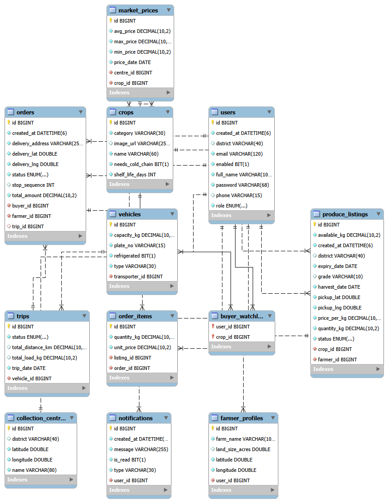

# Agri-Tech Supply Chain Optimizer (GoviRoute)

Many Sri Lankan farmers sell their harvest without knowing the prices at the
economic centres, and a lot of fresh produce spoils before it reaches buyers.
GoviRoute connects farmers, buyers and transporters on one website. Farmers can
list their harvest and see which market pays the most after transport, buyers
can order fresh produce straight from farms, and transporters get full,
well-planned delivery trips.

## Tech stack
- Frontend: React (Vite)
- Backend: Spring Boot, Spring Security, Spring Data JPA
- Database: MySQL

## Setup

### Prerequisites
- JDK 25 (with `JAVA_HOME` pointing to it)
- Node.js 24 or newer
- MySQL 8.4 LTS or newer (developed on MySQL 9.7)
- Git

### 1. Create the database
Log in to MySQL as root and run:

```sql
CREATE DATABASE agritech_db CHARACTER SET utf8mb4 COLLATE utf8mb4_unicode_ci;
CREATE USER 'your_user'@'localhost' IDENTIFIED BY 'your_password';
GRANT ALL PRIVILEGES ON agritech_db.* TO 'your_user'@'localhost';
```

### 2. Run the backend (port 8080)
```bash
cd backend
copy .env.example .env      # then put your MySQL user and password in .env
mvnw spring-boot:run        # Windows; use ./mvnw on macOS/Linux
```

### 3. Run the frontend (port 5173)
```bash
cd frontend
copy .env.example .env
npm install
npm run dev
```

Open http://localhost:5173 in your browser.

## Database design

The schema has 12 tables. 



## Author
Ashmi Hettige