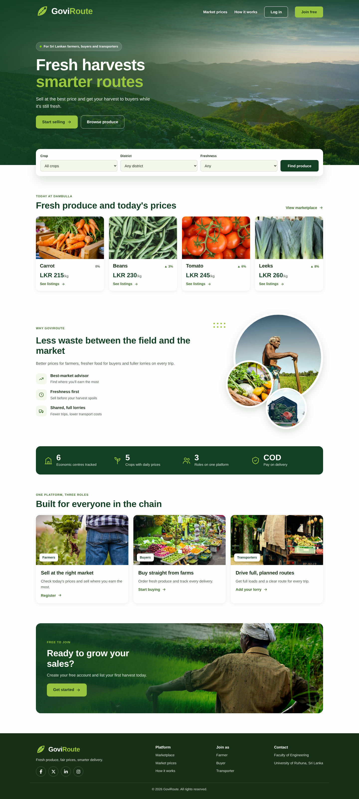
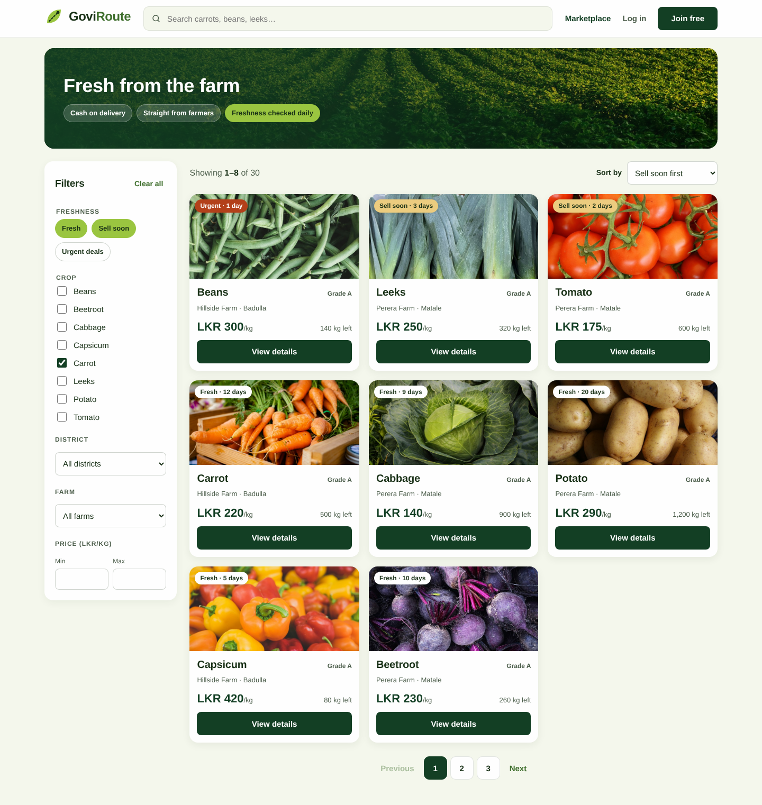
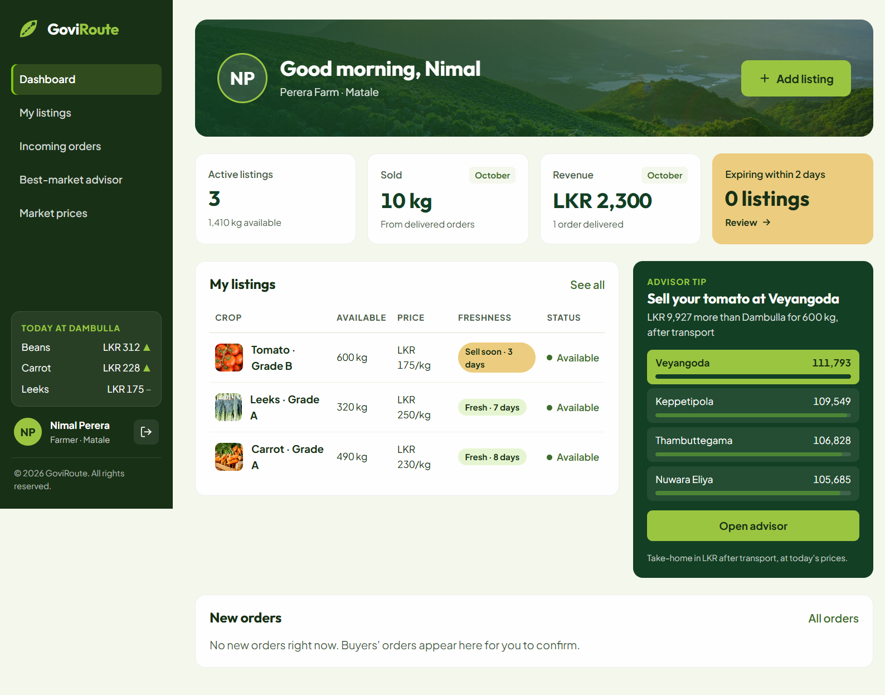
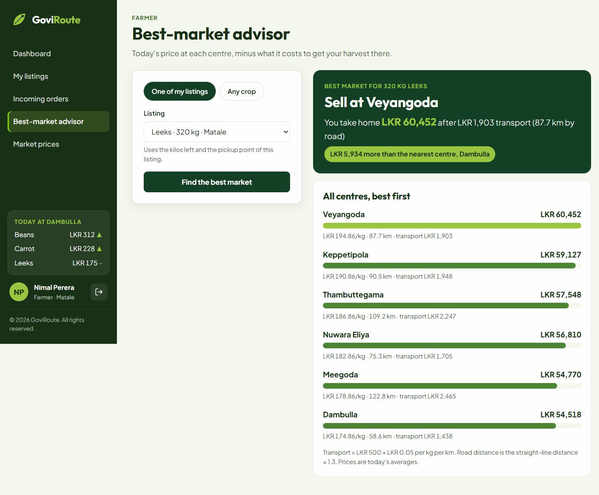
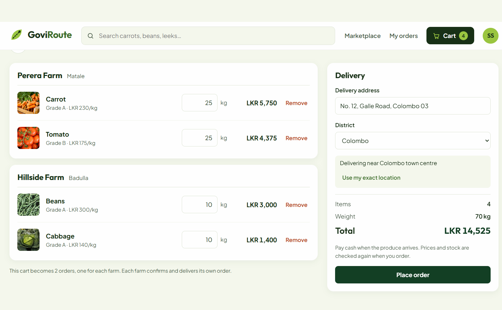
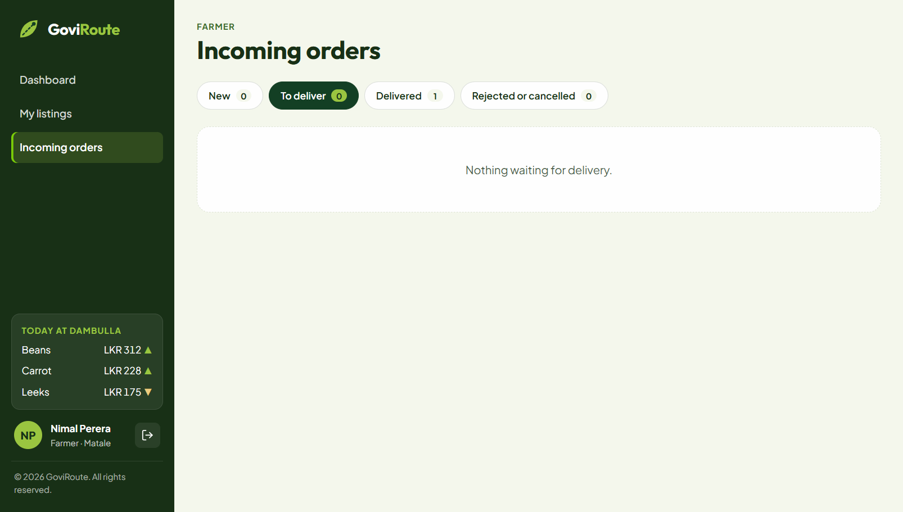
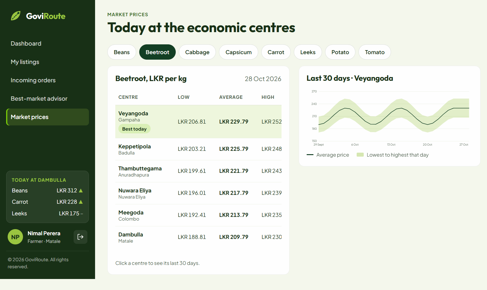
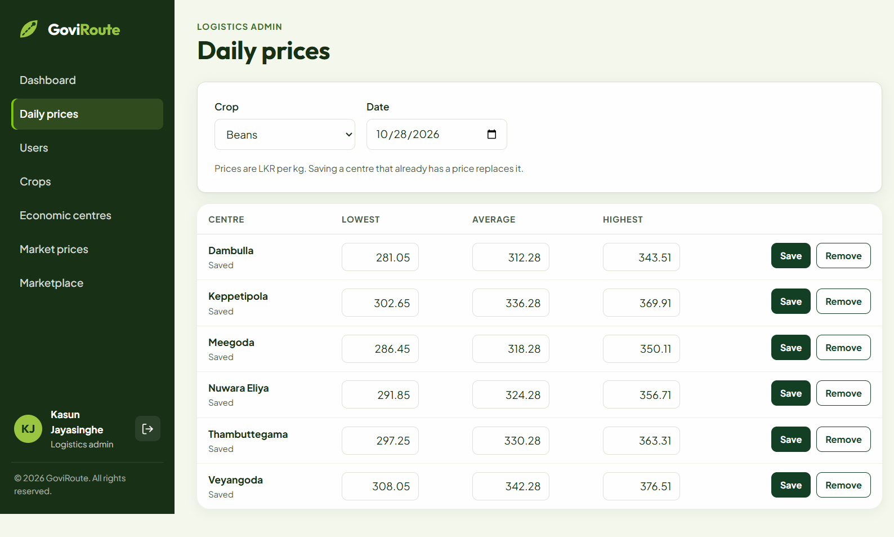

# Agri-Tech Supply Chain Optimizer (GoviRoute)

Many Sri Lankan farmers sell their harvest without knowing the prices at the
economic centres, and a lot of fresh produce spoils before it reaches buyers.
GoviRoute connects farmers, buyers and a logistics admin on one website. Farmers
list their harvest and see which market pays the most **after transport**, buyers
order fresh produce straight from farms, and the admin keeps the daily market
prices up to date.


## Features

| Role | What they can do |
|---|---|
| **Farmer** | Add, edit, pause and delete produce listings (a listing with orders is archived instead of deleted) · see a freshness badge on every listing · confirm, reject and deliver incoming orders · dashboard with sales, revenue and an advisor tip · **best-market advisor** · market prices with a 30-day chart |
| **Buyer** | Search the marketplace by crop, district, farm, freshness and price, with sorting and pages · add to cart · check out (one order per farm, cash on delivery) · follow and cancel orders |
| **Logistics admin** | Enter daily prices for each crop and centre · add, edit and delete crops and economic centres · find users and disable or enable accounts · platform stats |
| **Everyone** | Landing page with live prices · register and log in (JWT) · role-based pages |

### How the "smart" parts work

**Freshness score.** `score = days left ÷ crop shelf life`. Above 0.5 is *Fresh*,
above 0.2 is *Sell soon*, otherwise *Urgent*. The marketplace can filter by it in
SQL using the same rule without decimals (`2 × daysLeft > shelfLife` for Fresh).

**Best-market advisor.** For each economic centre:

```
road km        = Haversine straight-line km × 1.3
transport cost = 500 + 0.05 × kg × road km          (LKR, set in application.properties)
net value      = today's price × kg − transport cost
```

The centre with the highest net value is the best market. A higher price far away
can lose to a lower price nearby. `BestMarketCalculatorTest` has a worked example.

**Safe checkout.** Checkout locks the listing rows (`SELECT … FOR UPDATE`), so two
buyers cannot buy the same last kilos. Stock drops when an order is placed and goes
back if the farmer rejects or the buyer cancels.

## Tech stack

- **Frontend:** React 19, Vite 8, React Router 7, Axios
- **Backend:** Spring Boot 4.1 (Java 25), Spring Security with JWT, Spring Data JPA (Hibernate 7), Bean Validation
- **Database:** MySQL 9.7

## Project structure

```
backend/   Spring Boot API
  config/        security rules, first admin account
  controller/    REST endpoints
  dto/           request and response records, with validation
  entity/        JPA entities (12 tables)
  exception/     one JSON error format for the whole API
  optimizer/     freshness score, Haversine distance, best-market calculator
  repository/    Spring Data repositories and Specifications
  security/      JWT filter and service
  service/       business rules
frontend/  React app
  api/  components/  context/  hooks/  layouts/  pages/  styles/  utils/
docs/      ER diagram and screenshots
```

## Setup

### Prerequisites
- JDK 25 (with `JAVA_HOME` pointing to it)
- Node.js 24 or newer
- MySQL 8.4 LTS or newer (developed on MySQL 9.7)
- Git

### 1. Create the database
Log in to MySQL as root and run:

```sql
CREATE DATABASE agritech_db CHARACTER SET utf8mb4 COLLATE utf8mb4_unicode_ci;
CREATE USER 'your_user'@'localhost' IDENTIFIED BY 'your_password';
GRANT ALL PRIVILEGES ON agritech_db.* TO 'your_user'@'localhost';
```

### 2. Run the backend (port 8080)
```bash
cd backend
copy .env.example .env      # then fill in .env (see below)
mvnw spring-boot:run        # Windows; use ./mvnw on macOS/Linux
```

In `.env`:
- `DB_USERNAME`, `DB_PASSWORD`: your MySQL user
- `JWT_SECRET`: a random 32-byte key in Base64. In PowerShell:
  `[Convert]::ToBase64String((1..32 | ForEach-Object { Get-Random -Maximum 256 }))`
- `ADMIN_EMAIL`, `ADMIN_PASSWORD`: the first logistics admin account, created on startup

Hibernate creates the tables. `data.sql` then adds 8 crops, 6 economic centres
and 30 days of sample prices (it is safe to run again on every start).

### 3. Run the frontend (port 5173)
```bash
cd frontend
copy .env.example .env
npm install
npm run dev
```

Open http://localhost:5173 in your browser.

### 4. Run the tests
```bash
cd backend
mvnw test
```

| Test | What it checks |
|---|---|
| `FreshnessScorerTest` | Fresh / Sell soon / Urgent boundaries and expired listings |
| `GeoDistanceTest` | Haversine distance (Colombo to Kandy ≈ 94 km) |
| `BestMarketCalculatorTest` | Transport cost, net value and ranking, worked by hand |
| `RequestValidationTest` | Validation rules on listing, checkout and price forms |
| `AgritechOptimizerApplicationTests` | The whole app starts (needs MySQL running) |

## Database design

The schema has 12 tables: `users`, `farmer_profiles`, `crops`, `collection_centres`,
`market_prices`, `produce_listings`, `orders`, `order_items`, `vehicles`, `trips`,
`notifications` and `buyer_watchlist`.


Design choices:
- `market_prices` has a unique key on (crop, centre, date) and an index on (crop, date).
- Money uses `DECIMAL(10,2)`, never floating point.
- `order_items.unit_price` is copied at checkout, so later price changes don't alter old orders.
- Users are disabled, never deleted, so order history stays complete.

## REST API

All endpoints are under `/api`. 🔒 means a JWT is needed (`Authorization: Bearer <token>`).

| Method | Path | Who |
|---|---|---|
| POST | `/auth/register`, `/auth/login` | anyone |
| GET | `/auth/me` | 🔒 any role |
| GET | `/crops`, `/centres`, `/farms`, `/prices/latest?cropId=`, `/prices/history?cropId=&days=` | anyone |
| GET | `/listings?q=&cropId=&district=&farmerId=&freshness=&minPrice=&maxPrice=&sort=&page=` | anyone |
| GET | `/listings/{id}` | anyone |
| GET | `/listings/mine` | 🔒 farmer |
| POST, PUT, DELETE | `/listings`, `/listings/{id}` | 🔒 farmer (own listings) |
| PATCH | `/listings/{id}/status` | 🔒 farmer (pause / resume) |
| POST | `/orders` | 🔒 buyer (checkout) |
| GET | `/orders/mine` | 🔒 buyer |
| GET | `/orders/incoming`, `/orders/summary` | 🔒 farmer |
| PATCH | `/orders/{id}/status` | 🔒 farmer (confirm, reject, deliver) or buyer (cancel) |
| GET | `/advisor?cropId=&quantityKg=&lat=&lng=` | 🔒 farmer |
| GET | `/admin/stats`, `/admin/users`, `/admin/prices?date=&cropId=` | 🔒 admin |
| POST, PUT, DELETE | `/admin/crops`, `/admin/centres` | 🔒 admin |
| PUT, DELETE | `/admin/prices` | 🔒 admin |
| PATCH | `/admin/users/{id}/enabled` | 🔒 admin |

Errors always come back in one format, for example a 400 with `fieldErrors`:

```json
{ "status": 400, "error": "Bad Request", "message": "Some fields are invalid",
  "path": "/api/orders", "fieldErrors": { "deliveryAddress": "Delivery address is required" } }
```

## Screenshots

| | |
|---|---|
|  |  |
|  |  |
|  |  |
|  |  |

## Git workflow

- `main`: submitted versions only. `develop`: working version.
- One `feature/...` branch per piece of work, merged into `develop` with a pull request.
- Commit messages follow Conventional Commits, e.g. `feat(order): checkout, order status flow…`.

## Future work

- Trip planning for transporters (vehicles and trips tables are already in the schema)
- Notifications page (notifications are already saved for order events)
- Buyer watchlist for price alerts

## Credits

Photos are from [Unsplash](https://unsplash.com) under the Unsplash License. See
`frontend/public/images/CREDITS.txt`.

## Author
Ashmi Hettige
